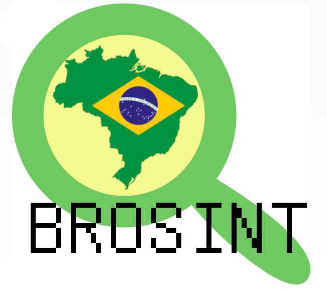

 
  
# 🇧🇷 BROSINT
### Comunidade Brasileira de OSINT para apoio às boas e justas causas.

**Aprenda, compartilhe conhecimento, ajude os necessitados e evolua com a comunidade brasileira de OSINT (inteligência de fontes abertas).**

---

## 🧭 Navegação

[Sobre](#-sobre-a-brosint) · [OSINT](#-o-que-é-osint) · [Nossa proposta](#-nossa-proposta) · [Quem pode participar](#-para-quem-é-a-comunidade) · [Voluntariado e Projeto Social](#-voluntariado-e-projetos-sociais) · [Como participar](#-como-participar) · [Contato](#-redes-e-contato) · [Contribua](#-contribua)

---

## 👋 Sobre a BROSINT

BR OSINT (BROSINT) é a comunidade brasileira dedicada ao estudo, à prática e à troca de conhecimento sobre **Open Source Intelligence (OSINT)** e temas relacionados.

Nossa missão é criar um espaço acessível, colaborativo e profissional para pessoas que desejam aprender, desenvolver habilidades, compartilhar conhecimento e contribuir para a comunidade de inteligência de fontes abertas no Brasil, além de criar iniciativas de ajuda às comunidades do Brasil.

## 🔎 O que é OSINT?

OSINT (*Open Source Intelligence*) é a coleta, análise e interpretação de informações públicas disponíveis em fontes abertas, como:

- 🌐 Redes sociais e conteúdo disponível na internet
- 📰 Notícias e publicações
- 📄 Documentos e registros públicos
- 📊 Dados abertos

O objetivo não é apenas encontrar informações, mas também analisá-las de forma ética, crítica e útil.

## 🎯 Nossa proposta

A BROSINT foi criada para:

- 📚 Difundir conhecimento sobre OSINT e áreas afins
- 🤝 Conectar pessoas interessadas no tema e incentivar a troca de experiências
- 🌱 Voluntariado Digital, ajudando na prática as pessoas, comunidades e projetos com o uso do OSINT
- 🛡️ Promover uma comunidade respeitosa, ética e colaborativa
- 🧭 Apoiar iniciantes e profissionais em diferentes níveis

## 👥 Para quem é a comunidade?

A BROSINT é pensada para iniciantes, estudantes, pesquisadores, profissionais de segurança, análise, tecnologia e comunicação — e para qualquer pessoa curiosa sobre investigação e análise de informações públicas.

**Não importa o nível: o importante é a vontade de aprender e colaborar.**

##  Voluntariado e Projetos Sociais
- Projeto Doação Segura - Combate às fraudes e estelionato digitais no Brasil. [Em construção]

## 🚀 Como participar

Você pode fazer parte da comunidade de várias formas:

- Acompanhar conteúdos e discussões
- Compartilhar materiais e experiências
- Participar de debates
- Contribuir com ideias, sugestões e projetos
- Ajudar outras pessoas a evoluir

## 🔗 Redes e contato

- **Discord:** https://discord.gg/9KjTkvwsra
- **LinkedIn:** em construção..

## 💡 Contribua

A comunidade cresce com colaboração. Se você tem conhecimento para compartilhar, ideias para propor ou conteúdo para contribuir, fique à vontade para participar.

### **Estude, evolua, ajude. Seja um BROSINTR!**

---

> “Conhecimento não é aquilo que você sabe, mas o que você faz com aquilo que você sabe.” — Aldous Huxley
>
> “O conhecimento serve para encantar as pessoas. Não para humilhá-las.” — Mário Sérgio Cortella
>
> “O conhecimento se adquire e a virtude se exercita.” — Sabedoria popular

**Seja bem-vindo(a) à BROSINT!** 🇧🇷

